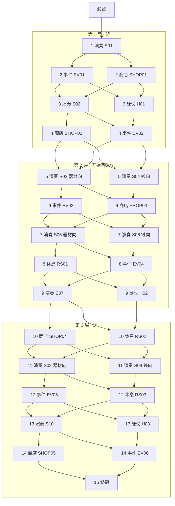

> **English summary** — Route design for chapter 1: how the run gives the player real choices, in the
> spirit of Slay the Spire, Arknights' Integrated Strategies and ZZZ's Hollow Zero. A run is 15 steps
> (plus the start): seven *performance steps* (each a choice between a normal performance and a hard
> fight, or between two performance flavours) and seven *resource steps* (each a choice between shop /
> event / rest), then the single finale. The count of performances per run stays fixed at seven, so the
> 20–30 minute rhythm and the economy baseline from the design doc survive while the mix of shops,
> events and rests becomes the player's own doing. Contains the composition rules a generator must
> follow, a hand-authored first map (node and edge tables), the information model, the implementation
> impact, and the decisions still open. Supersedes the linear route used by commit `d8bf25a`.

---

# 第一章路线图：分支与选择

> 状态：**策划案（2026-09-27）**。这一稿回应主策的否决："没有分叉是不应该的"。
> 上一版（提交 `d8bf25a`）把 16 站排成一条直线，是把设计稿自己写的参照坐标
> （《绝区零》零号空洞 + 《明日方舟》集成战略）当成了"以后随机化再说"。这一稿改回来。
>
> **本文档只管"路"，房间的内容仍然看 `docs/chapter-rooms-spec.md`。**

---

## 1. 三款参照，各自拿什么

| 参照 | 它的做法 | 我们拿走的规则 |
| --- | --- | --- |
| 《杀戮尖塔》 | 一层 15 行，每行 1–4 个节点、每个节点连 1–3 条出边；玩家每步从 1–3 个里挑一个；节点类型（战斗 / 精英 / 事件 / 商店 / 休息 / Boss）有配额与构图约束 | **行式分支**：一局固定走 15 步，每步在 1–3 个候选里挑；**路径是玩家走出来的** |
| 《明日方舟》集成战略 | 每层一张小图，类型可见、内容不可见；分歧之后会汇合；有情报类增益（提前看见后面是什么） | **汇合**：分支必须在一两步内合流，不做指数爆炸；**情报**：未知节点的信息由道具/旅伴揭示 |
| 《绝区零》零号空洞 | 一屏看得见整层的格子与岔路，玩家自己排顺序；推进有"探索度"式的整体感 | **一屏看得见**：整层在一屏里，节点与连线都画出来；不要"走到跟前才知道" |

——

## 2. 核心模型：大类固定，类内选择

一局 = **起点 + 15 步**，15 步由三部分构成：

```
起点 ── 7 个「演奏步」 ── 7 个「资源步」 ── 终房
        每步二选一：          每步二选一或三选一：
        普通演奏 / 硬仗        商店 / 事件 / 休息
        （或两种倾向的演奏）
```

| 口径 | 值 | 为什么这么定 |
| --- | --- | --- |
| 一局步数 | 恒 15 步（+ 起点 = 16 站，与设计稿 §3.1 一致） | 保住 20–30 分钟与"7 场演奏"的节奏 |
| 一局演奏数 | **恒 7 场** | 设计稿 §3.1 与 §6 的经济都是按每局 7 场算的；浮动会让经济随运气抖 |
| 一局硬仗数 | 0–3 场（基准 2） | 演奏步里只有 3 步提供硬仗候选（每层一个），选不选是玩家的风险偏好 |
| 一局商店 / 事件 / 休息 | 7 个资源步里自由分配（基准 2 / 3 / 2） | **这是"选择"的主要来源**：不买器材的人，这一局会更轻，也更穷 |
| 每步候选数 | 默认 2，最多 3 | 1 个没得选、4 个以上变成挑花眼；3 个是 StS 的上限 |
| 第 1 步与终房 | 唯一，不给选择 | 开场要给一个稳的落点；终房是这一程的落点，不是分叉点 |

> 与设计稿的关系：设计稿 §3.1 的"演奏 7 / 商店 2 / 事件 3 / 休息 2 / 终房 1 = 16"被读成
> **一局的基准配额**。演奏数照旧锁死 7；商店/事件/休息的实际比例由玩家的路决定（§4 的图里，
> 资源步的候选集合保证了每一样都至少有机会遇到一次）。

---

## 3. 构图规则（手写图与将来的生成器都要守）

1. **第一步必是演奏**：开场先给一场，别让玩家第一屏就在"商店还是事件"里迷路。
2. **终房唯一**，在最后一行的正中；第三层的每一条分支都必须能走到它。
3. **演奏步与资源步交替出现**：不允许连着 3 步同类（避免"连打五场"或"连逛三家店"）。
4. **硬仗不连着硬仗**，且不出现在第一步；同一层的硬仗候选最多一个。
5. **休息房至少能遇到一次**：7 个资源步里至少 3 步的候选含休息。
6. **商店至少能遇到一次**：7 个资源步里至少 4 步的候选含商店（钱要有处可花）。
7. **分支必须汇合**：任何一行的候选，1–2 行内必须重新合流；汇合点保存"最少 1 条"出边。
8. **每行候选数 1–3**，默认 2。
9. **相邻行的连线不交叉**：节点按列排，出边只连到下一行的同列或相邻列（一屏画得清）。
10. **每一条边都要能走通**：不允许生成"死胡同"（除终房）与"到不了终房"的分支。

---

## 4. 第一版地图（手写，可直接实现）

行 = 一步；每行 2 个候选（第一步与终房 1 个）。**地图上共 28 个房间，一局走其中 15 个 + 起点。**



### 4.1 每步候选表

| 步 | 候选 A | 候选 B | 这一步在选什么 |
| --- | --- | --- | --- |
| 1 | 演奏 S01 | — | 没有选择（开场） |
| 2 | 事件 EV01 | 商店 SHOP01 | 白拿一件带代价的东西，还是花钱买 |
| 3 | 演奏 S02 | 硬仗 H01 | 稳妥一场，还是拿更高的收益冒一次险 |
| 4 | 商店 SHOP02 | 事件 EV02 | 花钱，还是拿事件 |
| 5 | 演奏 S03（器材向） | 演奏 S04（钱向） | 这一站更可能出器材，还是更可能出钱 |
| 6 | 事件 EV03 | 商店 SHOP03 | 同第 2 步，位置更靠里 |
| 7 | 演奏 S05（器材向） | 演奏 S06（钱向） | 同第 5 步 |
| 8 | 休息 RS01 | 事件 EV04 | 清负面/回状态，还是赌事件 |
| 9 | 演奏 S07 | 硬仗 H02 | 第二层的"要不要冒险" |
| 10 | 商店 SHOP04 | 休息 RS02 | 花钱，还是休整 |
| 11 | 演奏 S08（器材向） | 演奏 S09（钱向） | 同第 5 步 |
| 12 | 事件 EV05 | 休息 RS03 | 赌事件，还是清负面 |
| 13 | 演奏 S10 | 硬仗 H03 | 第三层的"要不要冒险" |
| 14 | 商店 SHOP05 | 事件 EV06 | 最后的花钱机会，还是不花 |
| 15 | 终房 | — | 没有选择（落点） |

**"兜底不给选择"的代价写在边上**：第 3、5、7… 步里，选硬仗的人下一步能去的候选会少一个
（例：`R32 硬仗 → 只能去 R42 事件`，而 `R31 演奏 → 商店或事件都能去`）。这是"风险换机会"的直译，
也是让玩家感到"这条路是我自己挑的"的关键。

### 4.2 关卡与房间配表（表结构草案）

```text
ChapterRoomRow  : room_id / layer / step / column / room_kind / stage_id / tags[] / enabled
ChapterEdgeRow  : edge_id / from_room_id / to_room_id / route_price
```

| 字段 | 说明 |
| --- | --- |
| `step` | 第几步（1–15），决定它在第几行 |
| `column` | 行内第几列（0–2），决定左右位置与连线不交叉 |
| `room_kind` | 演奏 / 硬仗 / 商店 / 事件 / 休息 / 终房（起点只有一个） |
| `stage_id` | 演奏类房间对应的关卡；硬仗按层共用一个 `H01/H02/H03` |
| `tags` | 演奏房的"倾向"（`equip` / `cash`），供奖励权重微调与 UI 显示 |

一局的关卡数 = 7（每个演奏步贡献一个），与设计稿一致；**地图上的关卡行 = 7 普通 + 3 硬仗 = 10**。

---

## 5. 信息模型：看得见什么，什么时候

| 状态 | 玩家看到 | 备注 |
| --- | --- | --- |
| 当前站 | 房间名 + 类型 + 一句话 | 与现在的界面一致 |
| 相邻的下一步 | 类型 + 房间名（**内容不可见**） | 让人能选路，但选不到"结果" |
| 更远的行 | 只有"？" | 情报类道具的用武之地 |
| 走过的路 | 保留痕迹（已走过的连线变暗） | 一屏能看出自己挑了什么 |

两件已有的设计在这里重新有了意义（**顺带发现一处重复**）：

- `CG03 抄歌本`（本层剩余房间可见）与旅伴"开货车的司机"（本层剩下的节点对你可见）**做的是同一件事** →
  需要区分：建议**抄歌本 = 看见本层所有房间的类型**，**司机 = 看见下一层的房间类型**（越远的情报越贵）。

---

## 6. 实现影响（先列清，等拍板再动代码）

| 要改的地方 | 为什么 | 风险 |
| --- | --- | --- |
| `PortfolioGrowthRunData.stageIds` | 现在开局就把整条的关卡清单走完存下来；分支之后**必须先走再知道** → 改成进入演奏房时追加 | 存档结构与校验要一起改；旧档按"旧版本局"处理 |
| `PortfolioGrowthService.Begin / EnterRoom` | Begin 不再预走路线；EnterRoom 要在**多个后继**里校验"是不是合法候选" | 现有"不能跳站/不能回头"的校验要重新写 |
| `ReadRun` 校验 | 关卡清单不再等于整章配额 | 需要"路径与地图一致"的新校验 |
| 地图 UI | 要画多出边、候选高亮、未知行、已走过的痕迹 | 视觉改动，按铁律 8 先出效果图 |
| 模拟器 `balance_sim.py` | 现在是"按房间顺序跑一条线" → 要能按策略模拟不同路线 | 经济结论会从"确定值"变成"分布" |
| 自检 | 章节走法要改成"沿着一条合法路线走到终房" | 现有 `WalkChapter` 助手要重写 |
| 路线随机化（roadmap D6） | 第一版是手写固定图；将来由生成器按 §3 的规则生成 | 生成器必须复用同一套构图规则与校验 |

---

## 7. 待拍板

1. **节奏模型**：本方案"一局恒 7 场演奏 + 类内选择"；或者走"浮动 6–8 场"（更像杀戮尖塔，经济与时长随路浮动）。
2. **每步候选数**：默认 2 还是允许 3（3 更热闹，地图也更宽）。
3. **信息模型**：相邻行"类型可见"（本方案），还是连类型也藏（更接近零号空洞的未知感）。
4. **演奏房的"倾向"标签**（器材向 / 钱向）：要不要做；不做的话，第 5、7、11 步的候选就只是两个不同的场景。
5. **第一版**：先落这张手写图，还是直接做生成器（roadmap D6）。
6. **抄歌本 vs 司机**的情报分工（§5 的建议）。

---

## 8. 验收模板

1. **自检**：从起点任意选一条合法路线都能走到终房；每条路的演奏数恒为 7；硬仗数在 0–3；不允许跳站、回头、走到死胡同。
2. **自检**：构图规则逐条可验（§3 的 10 条各一条断言）。
3. **Play**：走两条不同的路，确认商店/事件/休息的比例真的不同，且终房都能结算。
4. **日志**：整条路径打一行 `Debug.Log("[Route] ...")`，方便排查"为什么我这局没商店"。
