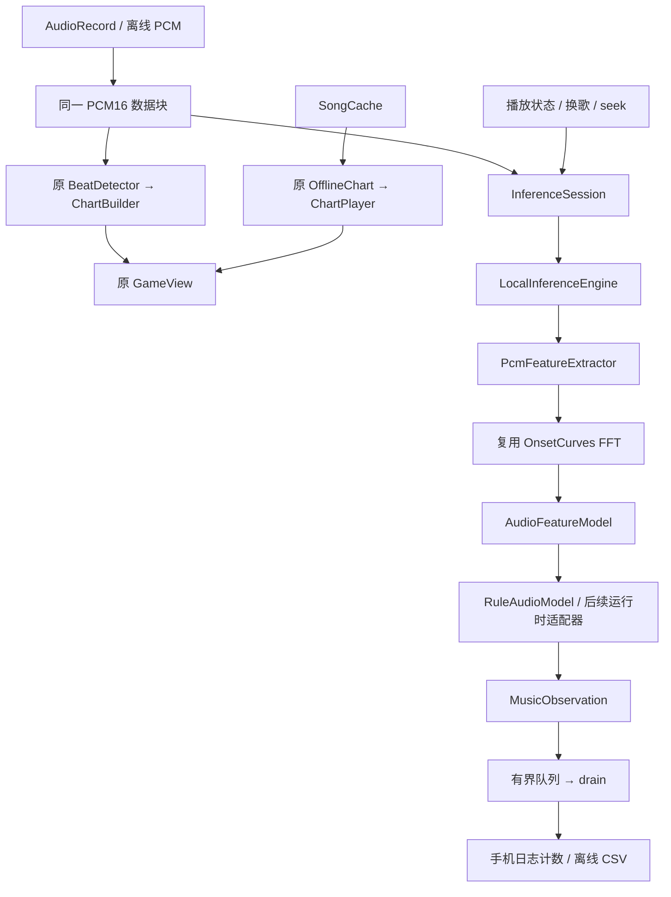

# 本地推理层：接手审计与实现说明

日期：2026-10-08。结论：**可复用现有项目，通过局部接口新增推理支路；不需要重写。**

## 资产审计

| 资产 | 实际情况与本次处理 |
| --- | --- |
| PCM 入口 | `CaptureService.run()` 使用 AudioPlaybackCapture / AudioRecord，单声道、44100 Hz、PCM16，每次最多读取 2048 个样本。新支路直接复用读取到的数组，不修改或持有输入数组。 |
| BeatDetector | 复用 OnsetCurves，承担实时节拍、预测、tap tempo。存在对 `Playback.available` 的直接读取，并非完全纯粹的独立计算类。本次未修改它。 |
| OfflineChart | 对整首 PCM 分析，复用 OnsetCurves，输出 notes、envelope、BPM、bar figures。不需要实时 detector 实例。未修改。 |
| SongCache | 保存原始 PCM16LE 与 index.json；校验录制起点、完成度和 seek，最多保留 12 首。不是模型输出缓存。未修改。 |
| GameView | 从 `CaptureService.detector/chartBuilder/chartPlayer` 及 Playback 静态状态读取，部分交互直接修改 detector。未改 UI。 |
| 时间轴 | BeatDetector 以累计采样计数推进，并用 nanoTime 最多外推 60ms；ChartPlayer 将播放器位置映射到捕获时钟。新推理层只用整数采样计数，不使用外推时钟。 |
| pause / seek | MediaWatcher 发布 playing、trackKey、seekGeneration、positionGeneration。旧捕获循环在 push/drain 后处理传输变化；ChartPlayer.poll 无显式 playing 检查，且捕获时钟在暂停时仍前进，存在旧谱面暂停显示的潜在缺口。本次不扩展到修复旧 UI/谱面行为。 |
| static / 跨线程耦合 | CaptureService 和 Playback 有较多 static volatile 状态；多个 volatile 字段不是原子快照；UI 与捕获 worker 共享 chart 队列。旧代码不是“完全解耦”，但新增推理层无需沿用这种设计。 |
| tools/raw | 五首歌曲 PCM 齐全，另有 silence、quiet_noise、joined。五个 `*_notes.txt` 含 java bpm、first notes、lead at emit 和 #end，属于旧算法/谱面输出格式，未发现可核实的人工鼓点标签。只作为参考一致性比较，不报告模型准确率。 |
| 单元测试 | 源码实际为 43 个：BeatDetector 4、ChartFile 8、MidiChart 10、MidiFile 12、SongCache 9。不是引用中所说的 44 个。 |

## 架构与改动



- 新增 `localai/` 下 8 个 Java 类：LocalInferenceEngine、StreamingLocalInferenceEngine、PcmFeatureExtractor、AudioFeatures、AudioFeatureModel、RuleAudioModel、MusicObservation、InferenceSession。
- CaptureService 在 PCM 入口创建并持有 InferenceSession；每块消费 Observation，每 2 秒输出 `[LocalAI]` 累计类型计数；停止时关闭。模型运行异常会禁用该支路，并继续旧音频/谱面流程。
- 不新增全局可变状态、不新增依赖。原 BeatDetector / OfflineChart / SongCache / GameView 的源码保持不变。
- 新增 LocalInferenceTest（15 个测试）、ObservationDump、tools/localai.ps1、tools/localai-baseline.csv；忽略 tools/out 中的编译与诊断输出。

## 时间与数据契约

`LocalInferenceEngine.pushPcm(short[] pcm, int offset, int count)` 接受 **44100Hz、单声道、有符号 PCM16**。文件工具接受对应的 little-endian `.raw`。其他采样率、立体声、WAV 容器需要先解码/转换；本接口不猜测格式。

`reset(long firstSample)` 清空未完成窗口、模型上下文和未消费事件，递增 segmentId。`drainObservations()` 转移输出；`close()` 释放模型资源且可重复调用。所有方法由单个 worker 拥有，不支持多个线程同时调用。

Observation 包含 type、confidence、features、segmentId、modelId、audioTimeSeconds。类型为 ONSET / KICK / SNARE / NOVELTY。`features.endSample` 是窗口末尾的 exclusive sample index；秒数严格为 endSample / 44100。它是捕获时钟，不是歌曲播放位置，不包含视觉延迟、预测提前量或音频输出延迟补偿。

InferenceSession 在送入 PCM 前处理换歌、seek、暂停/恢复和媒体会话可用性变化。暂停块推进捕获计数，但不送给模型；恢复重建窗口。没有媒体元数据时继续分析实际声音。操作发生在一个读取块内部时，边界精度仍受 AudioRecord 的块和系统状态通知延迟限制；它不能知道同一块内部的精确跳转样本。

特征窗口 2048 样本（约 46.44ms），hop 220（约 4.99ms）；Hann；复用 30–160Hz 与 1800–8000Hz 频带能量及其正向 log 差值。另算未加窗 RMS。第一完整窗口只建立规则基准；不足一帧的文件尾部不补零，不制造尾部事件。

默认输出缓冲最多 512 条，满时丢弃最旧事件并累计 droppedObservations；正常实时/离线调用每块 drain。此版规则为：静音门限、能量上升条件、自适应 onset 门限、80ms 起音间隔、频带标签、约 1 秒上下文的能量/音色 novelty。KICK/SNARE 是频带启发式标签，NOVELTY 不是已识别的乐段。confidence 是规则分数，尚未概率校准。

## 验证结果

- `./build.ps1 -Task test`：debug 与 release **各 58 个通过，0 失败、0 错误、0 跳过**（原有 43 + 新增 15）。原 ChartFileTest 实际解析了 37 个项目谱面。
- 新测试覆盖已知合成鼓点的时间与标签、停止边缘不重复起音、持续音、静音/低噪声、音色 novelty、任意分块、sample 时间戳、reset、暂停启动/恢复、seek、换歌、媒体元数据中断、输入不变、输出缓冲上限、错误参数、模型分数与资源生命周期。
- 首轮测试发现音符突然结束会重复触发 onset；增加上升能量条件后，合成四击得到恰好四个 ONSET。
- 八个真实/控制输入各以 2048 和 137 样本分块运行，事件和特征的 SHA-256 一致；无队列丢失；静音和低噪声零事件。建立 rules-v1 基线后再次运行并通过固定基线比较（包含 PCM 指纹）。该基线是本次建立的行为基线，不是人工真值。
- 桌面 JVM 新支路回归约 190–228 倍实时，仅代表本机离线表现，尚未测量手机额外 FFT 的延迟、耗电或热表现。

| 输入 | 秒数 | ONSET | KICK | SNARE | NOVELTY |
| --- | ---: | ---: | ---: | ---: | ---: |
| hitchcock | 222.8 | 442 | 75 | 76 | 93 |
| local_chiharu | 260.2 | 322 | 201 | 13 | 47 |
| local_feiniao | 213.3 | 300 | 198 | 11 | 59 |
| local_light | 252.5 | 683 | 461 | 10 | 67 |
| local_tada_kimi_ni_hare | 199.0 | 426 | 64 | 106 | 89 |
| silence | 30.0 | 0 | 0 | 0 | 0 |
| quiet_noise | 30.0 | 0 | 0 | 0 | 0 |
| joined | 483.0 | 761 | 277 | 88 | 141 |

原 BeatDump 和 ChartGenDump 也对五首歌执行，结果保存在 tools/out 的 `*-beat.txt` 和 `*-chart.txt`；它们是本次 smoke run，未把旧 notes.txt 当作必须复现的当前算法基线。

## 复现与 APK

从 overlay_beat 项目目录运行：

```powershell
./build.ps1 -Task test
./tools/localai.ps1 -Baseline tools/localai-baseline.csv
./tools/localai.ps1 -Pcm tools/raw/local_light.raw -Output tools/out/local_light-observations.csv
./build.ps1 -Task assembleDebug
```

assembleDebug 已成功。原位 APK：

`C:\Users\LorXer\Documents\trae_projects\FallenAngel\overlay_beat\app\build\outputs\apk\debug\app-debug.apk`

包名 `com.fallenangel.overlaybeat`，minSdk 29（Android 10），targetSdk 33。APK Signature Scheme v2 校验通过。SHA-256：`DF35FEE8244CF649B789604942EFAA8A7436B7995FB88BBB27AF7F95D0CEEE34`。

本次未在实体手机安装/运行；生成并校验 APK 不等于已验证各厂商的悬浮窗、媒体捕获权限和电量策略。安装后按既有流程授权悬浮窗/录音/媒体捕获，播放歌曲，在 OverlayBeat 日志中观察 `[LocalAI]`；暂停期间计数应停止增长，恢复/换歌/seek 后重新分析。已有 UI/谱面潜在问题与新增支路区分排查。

## 接真实小模型所需接口与材料

1. **同特征模型**：实现 `AudioFeatureModel.id() / infer(AudioFeatures) / reset() / close()`，注入 `new StreamingLocalInferenceEngine(adapter, 512)`。模型自行维护上下文张量与推理会话，在 reset 清理状态，在 close 释放 native 资源。
2. **输入契约**：`AudioFeatures.SCHEMA = overlay-bands-v1`；`toTensor()` 顺序为 `[rms, kickEnergy, snareEnergy, kickOnset, snareOnset]`，float32。训练/推理必须一致定义采样率、FFT、hop、窗函数、频带、归一化、上下文长度、因果性和标签顺序。该五维向量不能直接代替任意现成模型的 log-mel 输入。
3. **其他前端**：若模型需要 16kHz、log-mel、原始波形或不同窗口，实现另一个 LocalInferenceEngine，复用 InferenceSession 与 MusicObservation 输出。需明确重采样和模型输出到原捕获 sample clock 的映射，以及 lookahead/事件延迟；当前 AudioFeatureModel 的预测时间绑定当前帧末尾。
4. **运行时适配**：模型选定后再加入 ONNX Runtime Mobile 或 LiteRT 依赖、模型文件、ABI/算子支持、版本/校验、量化参数与资源释放逻辑。本次只实现可替换边界，未安装任一运行时，也未伪装有训练模型。
5. **评估数据**：补充逐事件时间和类型的人工标注、标注容差及训练/测试划分；增加 onset/kick/snare 的 precision/recall/F1、时延和误报率，再与当前规则基线同音频比较。当前五首歌曲的旧谱面输出不支持有效的鼓点识别准确率结论。
6. **手机性能**：在目标手机上测量每块推理耗时、峰值内存和功耗。当前规则轻量且同步运行在捕获 worker；较重模型应使用有界异步队列，明确掉块/reset 策略，不能阻塞捕获或无限堆积 PCM。

本次未提交 Git commit；改动保留为可检查的工作区文件。
